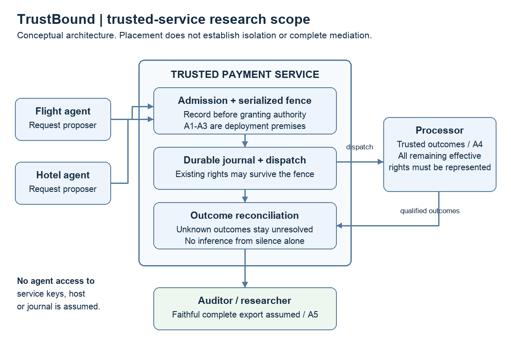

# TrustBound

**A research prototype for checking when a trusted payment service can account
for earlier payments and rule out further effects from earlier authority.**

TrustBound contains Lean models, an experimental Python service, reproducible
diagnostics, and a manuscript. Its contribution is a checked conditional model
and an explicit account of the assumptions needed to apply it.

[Problem](#the-problem) · [Supported result](#what-the-model-establishes) ·
[Quick start](#quick-start-reproduce-the-reviewer-artifact) ·
[Code map](#code-map) · [Development](#development-and-local-checks) ·
[Provider evidence](#provider-evidence) · [Paper and licensing](#paper-and-licensing)

## The problem

Imagine you ask an AI travel assistant to book a flight and a hotel. The assistant
is a software client: it sends payment requests to a separate payment service.
Once a request has been accepted, processing can continue independently of the
assistant that sent it.

Suppose the assistant sends a hotel payment request, but you tell it to stop
before a reply arrives. Stopping the assistant prevents it from sending new
requests; it does not automatically recall a request already sent. That request
may still be queued or in progress at the payment service or its provider, so
the hotel payment could complete after the assistant has stopped.

There is also a different source of uncertainty: the provider may have already
processed the payment, but its reply was lost. Even if the service subsequently
establishes that no further payment can occur, the earlier outcome remains
unknown until a trustworthy record establishes what happened. Preventing future
payments and accounting for past payments are therefore two separate obligations.

TrustBound studies **exact closure** for a fixed scope of payment operations,
called an **epoch**. Closure requires both:

- A complete account of which payment operations in that scope actually took
  effect, identified by their operation IDs.
- Evidence that no outstanding permission or in-flight request can produce
  another effect in that scope.

The research evaluates the service rules and evidence needed to establish these
conditions, not an AI agent's planning ability. Receipts and signed reports can
identify individual events or their sources, but they do not by themselves
establish that every relevant operation and remaining permission is accounted for.

## What the model establishes

The admission model connects three rules:

1. **Record before granting authority.** Each operation's identity must be in
   the service journal before it can receive permission to produce an effect.
2. **Fence admission.** Recording and granting authority are serialized with a
   fence that stops new admissions and fixes the journal's population.
3. **Discharge remaining rights and report outcomes truthfully.** Once earlier
   permissions can no longer produce effects, truthful outcomes for the fixed
   journal give exact identity-level accounting.

Under these rules, Lean checks that rights and effects stay within the fixed
journal after fencing, and that closure holds for every permitted finite
continuation once the remaining rights are discharged and outcomes are truthful.
The constrained provider model additionally requires registration before
activation and keeps unregistered objects inert.

These results assume a trusted service and journal, request-only agents without
host or credential access, mediation of every in-scope activation route,
committed state that is not rolled back, truthful provider outcomes and
irreversible discharge, and a faithful journal export. These are deployment
obligations, not facts established by running the artifact.

A fence alone does not cancel earlier requests, and drainage alone does not
reveal unknown past outcomes. This is **not a production payment service**,
a proof of monetary totals, or a new general closure principle. The Python
implementation is not proved to refine the Lean models for all executions.

See the [assumptions and claim boundaries](docs/CLAIMS.md),
[implementation evidence](docs/ASSUMPTION_EVIDENCE.md), and
[closure dependency diagram](docs/diagrams/completeness.png).
The [research contract](docs/RESEARCH_CONTRACT.md) defines the terminology,
positions the contribution as a mechanization note, and explains the agent role
and the evidence still needed for deployment.

## Quick start: reproduce the reviewer artifact

Run these commands from the repository or extracted reviewer-archive root on
Linux or macOS. You need **Python 3.11+** and a separate **Lean 4.19.0** installation.
The requirements file pins pytest 9.0.2 and its runtime dependencies. The recorded
environment uses Python 3.12.14 on Apple Silicon macOS; this is not a tested
platform matrix. The workflow needs no provider account, SDK, Docker, or network
access after dependency setup.

```sh
python3 -m venv .venv
.venv/bin/python -m pip install -r requirements-reviewer.txt
.venv/bin/python scripts/reproduce_reviewer_artifact.py \
  --lean /absolute/path/to/lean-4.19.0/bin/lean \
  --output results/my-reviewer-run
```

Replace the Lean path with your installed compiler. Use a new output directory
for each run. Assertion-based checkers reject `-O` and `PYTHONOPTIMIZE`.

[Download the versioned reviewer candidate](paper/release/TrustBound_Reviewer_Artifact_v1.1.0-review.1.zip)
and its [SHA-256 checksum](paper/release/TrustBound_Reviewer_Artifact_v1.1.0-review.1.zip.sha256).
The [reviewer guide](docs/REVIEWER_GUIDE.md) explains extraction, integrity checks,
scenario expectations, and how to rebuild the archive.

### Expected results

A successful run exits with status 0 and writes these outputs under the chosen
directory:

- **`summary.json`**: `checks_passed: true` records that the selected checks passed.
- **`core/admission/` and `core/provider_contract/`**: proof and mutation logs for **14
  exported results** and **eight rejected premise-removal mutations**.
- **`core/baseline-tests.xml`**: **nine diagnostic tests** passed.
- **`core/baseline/closure_benchmark.json`**: **2,048 synthetic diagnostic records**
  reproduce the saved result. Command logs and source hashes record the run's inputs.
- **`service-tests.xml`**: selected service, crash, trace-audit, and packaging tests.
- **`traces/`**: six histories with 66 transitions checked against Lean; five
  closed cases, one undrained case, and two rejected invalid inputs.
- **`exported-trace-audit.json`**: a separate audit of the exported histories,
  checking event mappings, authority/effect coverage, and expected outcomes.

The diagnostic reuses **64 distinct public inputs per arm**. Both strong labels
share one acceptance function, and both weak labels share another. Agreement is
a consistency control, not an independent product comparison or validation of
theorem soundness; the comparison implements no witnessing protocol.

A successful run is a **reproduction report**, not a closure certificate for a
real merchant. It makes no processor requests and does not establish deployment
assumptions A1–A5. See the [reviewer guide](docs/REVIEWER_GUIDE.md) for the current
workflow, the [core artifact guide](docs/CORE_ARTIFACT.md) for the narrower original
core-only command and provenance, and the
[recorded artifact check](evidence/final_assurance_2026-11-09/README.md) for the
fresh dependency installation on the same host.

## Code map

The repository includes a narrow formal core and a broader experimental codebase:

- **Paper core:** [Admission.lean](formal/Admission.lean) models fencing, identity
  coverage, and drainage; [StripeGate.lean](formal/StripeGate.lean) models the
  constrained provider contract. [reproduce_core_claim.py](scripts/reproduce_core_claim.py)
  runs the selected proof checks and evidence diagnostic.
- **Experimental service:** [stripe_gate.py](src/trustbound/stripe_gate.py)
  implements the persistent gate; [credential_service.py](src/trustbound/credential_service.py)
  exposes a restricted request interface. Neither establishes hostile-host isolation.
- **Service-to-model examples:** [service_refinement/](research/service_refinement/README.md)
  checks six service histories with 66 projected transitions: five reach the
  closure theorem and one remains undrained. These selected executions do not
  prove refinement for all implementation behavior.
  [trace_evidence.py](src/trustbound/trace_evidence.py) separately checks the
  supplied snapshots and command/event changes against the declared mapping.
- **Broader prototype:** [coordinator.py](src/trustbound/coordinator.py),
  [allocation.py](src/trustbound/allocation.py), and [epoch.py](src/trustbound/epoch.py)
  implement travel coordination, signed allocations, and local epoch models.
  [protocol.py](src/trustbound/protocol.py) uses pinned UCP/AP2 SDKs for local
  artifact generation and verification; it does not establish live conformance.
- **Other models and experiments:** [formal/](formal/README.md) and
  [research/](research/) retain separate amount, observer, dispatch, and candidate
  studies. They do not establish end-to-end monetary composition.
- **Checks and tools:** [tests/](tests/) contains unit, fault, crash, and synthetic
  interface checks. [scripts/](scripts/) contains reproduction tools, local
  checks, and opt-in provider probes.
- **Manuscripts and records:** [paper/](paper/README.md) contains the manuscripts
  and sources; [docs/](docs/), [evidence/](evidence/), and [results/](results/)
  contain explanations and recorded runs.



See [architecture and diagrams](docs/ARCHITECTURE.md) for the component boundaries.

## Development and local checks

After creating the virtual environment above, install the broader project's
dependencies, including the pinned UCP/AP2 SDK revisions, and run its test suite:

```sh
.venv/bin/python -m pip install -e '.[dev]'
PYTHONPATH=src .venv/bin/python -m pytest -q tests
```

Some tests use local processes and Unix sockets. Synthetic container-configuration
tests do not start Docker or establish OS isolation. Historical isolation helpers
remain for test compatibility, not as a recommended deployment.
See [validation notes](docs/VALIDATION.md) for the recorded environment and checks.

For the separate service trace checks and selected gate/interface/crash tests,
follow the [service reproduction guide](research/service_refinement/README.md#reproduction).

### Local processor simulation

This optional simulation needs no credentials and makes no Stripe API requests:

```sh
PYTHONPATH=src .venv/bin/python scripts/validate_completeness_boundary.py \
  --output results/my-local-boundary-run
```

Use a new output directory. The simulation's broader ledger can distinguish a
bypass that observations of known objects miss; it is not real-provider evidence.

## Provider evidence

Stripe has a historical bounded **test-mode** run, not production validation.
Adyen has a **documentation-only** contract review; no Adyen integration or test
payment was executed. See [provider evidence](docs/PROVIDERS.md) and
[focused references](docs/REFERENCES.md) for their distinct scopes.

Provider scripts are separate from ordinary reproduction. They require explicitly
supplied test credentials and may create, capture, book, or cancel test-account
objects. The [export manifest](EXPORT_MANIFEST.json) describes the repository's
contents; credentials and raw private provider records are excluded.

## Paper and licensing

The manuscript is a mechanization note on payment completeness, authored by
**Sandip Nandi — Independent Researcher**. Start with the
[manuscript guide](paper/README.md) for the author and anonymous versions, sources,
build instructions, and editorial history.

- [Supplementary record](paper/SUPPLEMENTARY_RECORD.md): detailed run history and
  the flight–hotel diagnostic.
- [Research scope decision](docs/TRIP_CLOSURE_CANDIDATE.md): why trip expansion and
  reserve optimization are outside the note's contribution.
- [Release candidate](paper/release/README.md): prepared artifact and reproduction
  records.
- [Submission status](paper/SUBMISSION_STATUS.md) and
  [submission guide](paper/ARXIV_SUBMISSION_GUIDE.md): publication and access logistics.

No open-source license has been granted. See [rights status](RIGHTS_PENDING.txt)
for the pending terms. Prepared manuscripts and artifacts do not imply publication,
a DOI deposit, or an arXiv submission.
