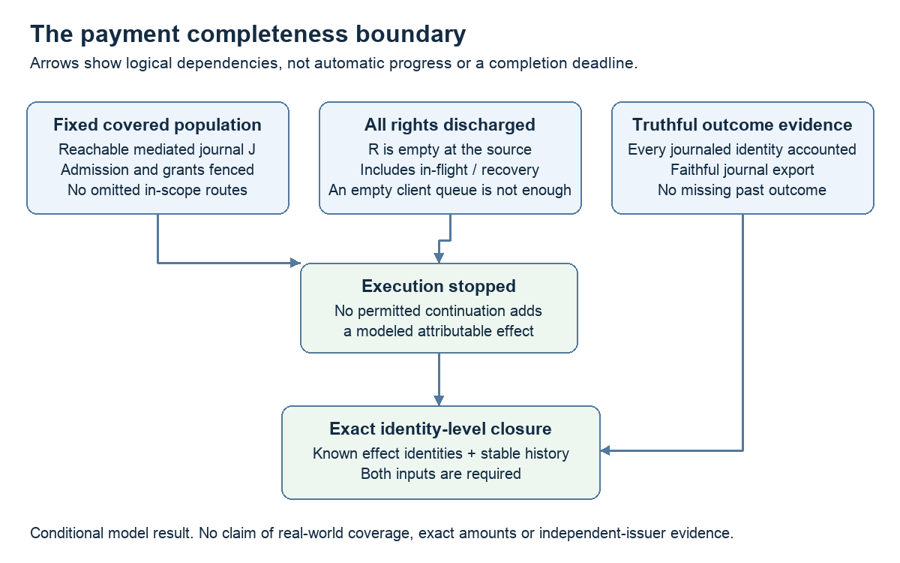

# TrustBound

**A research framework for reasoning about and testing payment-epoch completeness under explicit trusted-service assumptions.**

TrustBound asks a narrow question: after agents stop requesting new work, can we
account for every admitted payment and establish that earlier authority cannot
produce another effect? A receipt, an empty client queue, or a signed report is
not sufficient on its own.

This repository contains a research prototype, Lean models, local tests,
reproducible diagnostics, and a manuscript under author review. It is **not a
production payment service**, an independently certified completeness system,
or evidence of a new general closure principle. The Python implementation is
not proved to refine the Lean models.


## The supported boundary

Agents only propose requests. The payment service and its journal are trusted;
agents cannot access its host, credentials or administration. Every in-scope
activation route must be mediated. Provider outcomes and irreversible discharge
must be truthful, and the auditor must receive a complete faithful export.

Under the modeled rules, recording before granting authority and serializing
both with a fence derive a fixed journal covering all modeled rights and effects.
Discharging all outstanding rights and truthfully reporting past outcomes then
gives exact **identity-level** closure for every permitted finite continuation.



The diagram is a logical dependency map, not an algorithm that forces a provider
to finish. A fence alone does not drain earlier requests. Drainage alone does
not reveal unknown past outcomes. See [architecture and diagrams](docs/ARCHITECTURE.md)
and [claim boundaries](docs/CLAIMS.md).

## Start with the reproducible paper core

Use Python 3.11+ with pytest 9.0.2 and Lean 4.19.0. The recorded execution uses
Python 3.12.14 on Apple Silicon macOS; this is not a tested platform matrix.
The core needs no provider account, SDK, Docker, or network access after setup.

```sh
python3 -m venv .venv
.venv/bin/python -m pip install -r requirements-core.txt
.venv/bin/python scripts/reproduce_core_claim.py \
  --lean /absolute/path/to/lean-4.19.0/bin/lean \
  --output results/my-core-run
```

Replace the Lean path and use a new output directory. Do not invoke Python with
`-O`: the existing research checkers use assertions.

The saved 5 November core run checked **14 exported results**, rejected **eight
premise-removal mutations**, passed **nine tests**, and regenerated **2,048
diagnostic records**. Those records reuse **64 distinct public inputs per arm**.
The two strong labels share one acceptance function, so their tie is a consistency
control, not an independent product comparison or validation of theorem soundness.
The weak labels also share a function; no witnessing protocol is implemented by
that comparison. [Artifact instructions and provenance](docs/CORE_ARTIFACT.md).

## Research codebase

| Area | Contents | Evidence boundary |
|---|---|---|
| `formal/Admission.lean`, `formal/StripeGate.lean` | Fencing, identity coverage, drainage and constrained provider-contract mapping | Specified transition systems, not a verified processor |
| Other `formal/` modules | Amount bounds, observer reasoning, dispatch and rejected novelty candidates | Separate models; no end-to-end monetary composition |
| `src/trustbound/stripe_gate.py`, `credential_service.py` | Persistent gate and restricted request interface | Experimental implementation; no hostile-host isolation proof |
| `coordinator.py`, `allocation.py`, `epoch.py` | Travel coordinators, signed allocation and local epoch models | Broader prototype features, not the paper's novelty claim |
| `protocol.py` and related modules | Pinned UCP/AP2 artifact generation and verification | Local SDK usage, not merchant-server or live counterparty conformance |
| `tests/` | Local unit, fault, crash and synthetic interface checks | Passing tests do not establish all deployment premises |
| `scripts/` | Reproduction, offline checks and explicit provider probes | Provider probes are opt-in and can perform test-account operations |
| `paper/` | Reviewed draft PDF and LaTeX source | Author metadata pending; not submitted |

For the broader SDK-dependent tests, install the pinned project dependencies:

```sh
.venv/bin/python -m pip install -e '.[dev]'
PYTHONPATH=src .venv/bin/python -m pytest -q tests
```

These installation commands are instructions, not a claim of a fresh-machine
installation test. The current upload validation is recorded in
[validation notes](docs/VALIDATION.md). Some tests use local processes and Unix
sockets; synthetic container-configuration tests do not start Docker or establish
OS isolation. Historical isolation helper files are retained for test compatibility,
not as a recommended deployment or an active infrastructure task.

Run the credential-free paired processor simulation with:

```sh
PYTHONPATH=src .venv/bin/python scripts/validate_completeness_boundary.py \
  --output results/my-local-boundary-run
```

Use a new output directory. Its broader simulated ledger can distinguish a
bypass that known-object observations miss. It is not a Stripe API test.

## Stripe, Adyen and references

Stripe has a historical bounded **test-mode** run, not production validation.
Adyen has a **documentation-only** contract review; no Adyen integration or test
payment was executed. Their evidence levels must not be conflated.
[Provider evidence](docs/PROVIDERS.md) · [Focused references](docs/REFERENCES.md).

Do not run provider scripts as part of ordinary reproduction. They require
explicitly supplied test credentials and may create, capture, book or cancel
test-account objects. No credentials, raw private provider records, local
databases, installed dependencies, or workstation-specific account setup scripts
are included. [Export manifest](EXPORT_MANIFEST.json).

## Paper and release status

The paper is now an Option B mechanization note focused on payment completeness.
The [flight–hotel candidate check](research/flight_hotel/README.md) found no new
exact-closure composition counterexample for its declared finite scope.
The current revision explains why the restricted observation boundary motivates
the trusted-service scope and records one unpromised auditor-evidence question.
The [research decision and stop rule](docs/TRIP_CLOSURE_CANDIDATE.md) set aside
trip expansion and reserve optimization. The note does not depend on new research.
Calling the codebase a research framework does not strengthen its theorem,
novelty, conformance or deployment claims. The author is reviewing the paper;
the target arXiv submission date is **30 November 2026**, with author metadata,
account eligibility, category and licenses still to be finalized.

This is a private research repository. No open-source license has been selected
or granted; see [rights status](RIGHTS_PENDING.txt). No public publication or
arXiv submission is implied by this upload.
