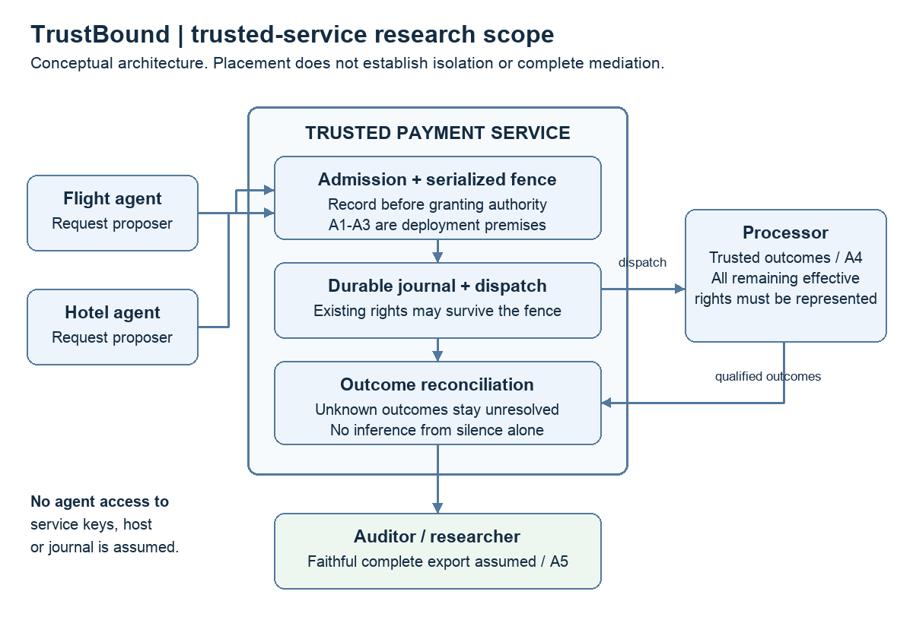
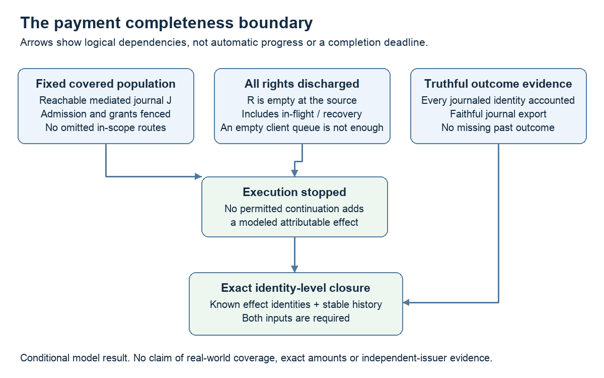
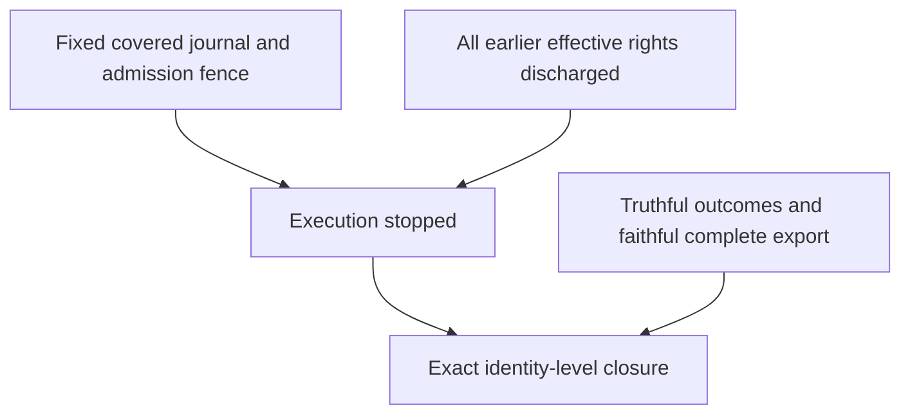

# Architecture and completeness diagrams

These diagrams describe the trusted-service research scope. They do not certify
an actual deployment, isolation boundary, provider contract or completeness source.

The agents propose requests. The service owns the journal, activation policy
and reconciliation. Source-side recovery remains outstanding authority until
qualified evidence discharges it. Provider observations are not independently
trusted just because they were obtained separately from the journal.

This second diagram is an AND-dependency map, not a sequential workflow:

1. The journal must cover the predefined population, and the fence prevents
   new admission/grants.
2. All earlier effective rights must be discharged at the source.
3. Truthful outcomes and a faithful complete export must identify past effects.

The first two establish future stability in the model. The third is additionally
needed for exact identity accounting. Outcomes may arrive before drainage;
there is no imposed observation order or guarantee of eventual completion.

## Editable Mermaid version

Each multi-input node requires **all** inputs. An uncertain outcome is not
treated as zero; stopping future work does not retrospectively reveal it.
Unknown inert objects are safe only under the constrained activation contract.

## Diagram source

The SVG files are editable vector assets; PNG files provide consistent GitHub
rendering. `diagrams/render.py` regenerates SVG, PNG and vector PDF with Python, Pillow and ReportLab. This
optional authoring dependency is not required to run TrustBound or its proofs.
Both diagrams were inserted into the 6 November manuscript revision with
explicit assumption-bounded captions. Vector PDF copies are included in the
self-contained LaTeX source directory.
